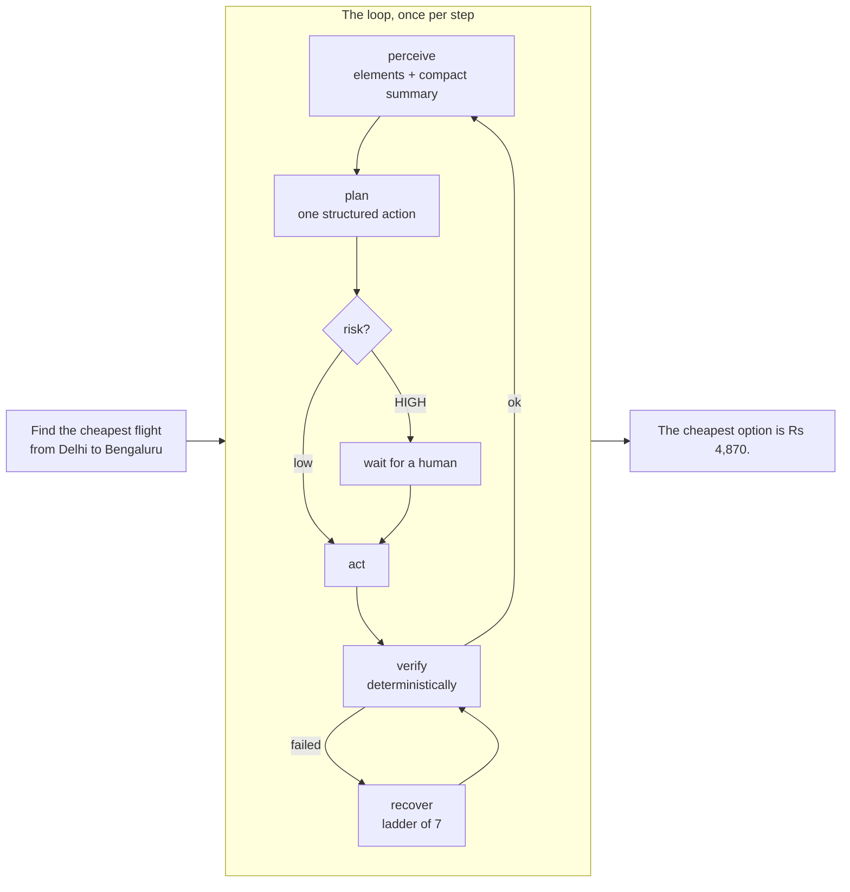
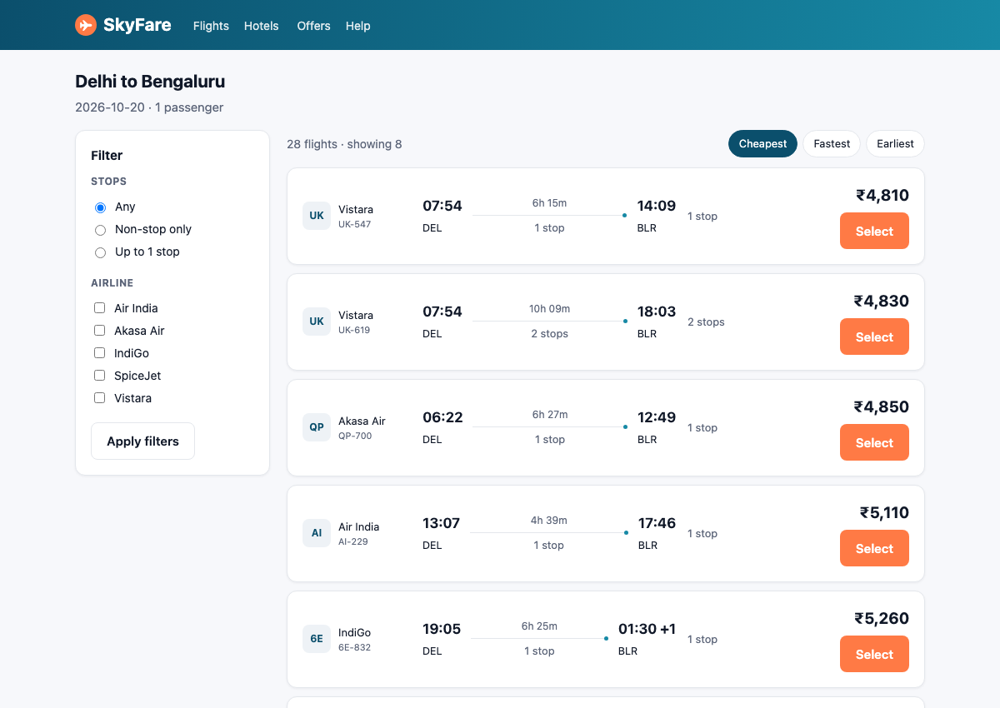

# Browser Automation Agent — backend

A supervised autonomous browser agent. A user writes a task in plain language; a
server-side Chromium reads the page, a language model proposes one structured
action at a time, the backend executes it, a **deterministic** verifier checks
what actually happened, and a recovery ladder handles the page breaking. Anything
irreversible stops and waits for a human. Every step is stored and streamed live.

This is the backend of **AI-07**, one of three repositories. It owns identity — it
is the only JWT issuer — the agent core, task and step persistence, the live
stream, and the demo sites the agent is tested against.

> **Student project.** Built for an OJT programme. It is not a product, it has
> never been deployed, and the disclaimer at the bottom of this page is not
> boilerplate: please read it before pointing it at anything.

## What it does



Full diagrams — system context, agent layers, one loop iteration, the task state
machine and deployment — are in **[docs/architecture.md](docs/architecture.md)**.

## Features

| | |
|---|---|
| **Perception** | Interactive elements from a real DOM, a ~3k-token summary, hidden elements excluded, BeautifulSoup fallback for static pages |
| **Planning** | Structured output against a JSON schema, one repair turn, four providers (Anthropic, OpenAI, Gemini, and a rule-based mock), versioned prompts recorded per step |
| **Visual grounding** | Set-of-marks: numbered boxes drawn over the elements, the model picks a number. Triggered rather than always on, and it degrades to DOM-only when vision is down |
| **Verification** | Eleven deterministic checks comparing two page states. Never asks the model whether its own action worked |
| **Recovery** | Seven ordered strategies, routed by the failure's error code, bounded at three attempts, one row per attempt |
| **Safety** | Deterministic risk rules (English and Hinglish), human approval before anything irreversible, eight layers of prompt-injection defence |
| **Multi-tab** | Stable tab ids, popups captured, a limit that holds against a page opening tabs in a loop |
| **Cache** | A completed task's verified sequence is replayed by the next identical one. The final answer is never cached |
| **Live view** | WebSocket with single-use tickets, replay from the database on reconnect, heartbeats |
| **Observability** | Sixteen Prometheus metrics, a stats endpoint, structured logs that are tested for secret leakage |
| **Billing** | Reserve synchronously, settle through a transactional outbox, against a payments service that is a separate repository |

## Quick start

For the repaired local setup and presentation steps, see **[Local demo guide](docs/LOCAL_DEMO.md)**.

### With Docker (nothing to install but Docker)

```bash
git clone https://github.com/Abhishek9639/browser-agent-backend.git
cd browser-agent-backend
make up
```

That builds two images and starts Postgres, the API and the SkyFare demo site.
The container applies migrations and generates a signing key on first start, so
there is no setup step.

- API: <http://localhost:8000/api/v1/health>
- Interactive docs: <http://localhost:8000/docs>
- SkyFare: <http://localhost:8200>

`make logs` follows it, `make down` stops it. The default provider is `mock`,
which is rule-based and offline, so the whole thing demonstrates itself with no
API key.

### Locally

```bash
cp .env.example .env
make install          # dependencies, Chromium, git hooks
make db-up            # Postgres in Docker
make migrate
uv run python scripts/gen_keys.py
make check            # lint, typecheck, unit tests
make dev              # the API on :8000, with reload
make skyfare          # the demo site on :8200, in another terminal
```

### Run a task

```bash
# Register and log in
curl -s -XPOST localhost:8000/api/v1/auth/register -H 'content-type: application/json' \
  -d '{"name":"You","email":"you@example.test","password":"a-long-passphrase"}'
TOKEN=$(curl -s -XPOST localhost:8000/api/v1/auth/login -H 'content-type: application/json' \
  -d '{"email":"you@example.test","password":"a-long-passphrase"}' | jq -r .accessToken)

# Submit a task against the demo site
curl -s -XPOST localhost:8000/api/v1/tasks -H "authorization: Bearer $TOKEN" \
  -H 'content-type: application/json' \
  -d '{"instruction":"Find the cheapest flight from Delhi to Bengaluru on 2026-10-29 on SkyFare",
       "startUrl":"http://skyfare:8200/"}'
```

Watch it live with `uv run python scripts/ws_watch.py <task-id>`, or poll
`GET /api/v1/tasks/{id}`.

Use `http://localhost:8200/` as the start URL when running locally rather than in
Docker: `skyfare` is the compose service name and only resolves inside the stack.

## The demo site

`demo_sites/skyfare/` is a flight search site written for this project. Flights
are generated deterministically from a seed, so the same search returns the same
results on any machine, and an oracle endpoint knows the right answer — which is
what makes "completed" into "completed **correctly**".

Nine chaos toggles reproduce what real sites do: `?chaos=cookie,popup,shuffle,layoutb,iframe,newtab,delay,inject`.



## Benchmark and demo

```bash
make chaos                          # ten chaos configurations, ~5 minutes
make bench runs=3 provider=mock     # writes docs/benchmarks/<date>-mock.md
```

The headline run is **[docs/benchmarks/2026-09-28-mock.md](docs/benchmarks/2026-09-28-mock.md)**:
thirty runs over ten chaos configurations.

| Metric | Result | Target |
|---|---|---|
| End-to-end success | **100%** | ≥80% |
| Recovery success | **100%** | >70% |
| Verification accuracy | 100% | — |
| Median time per task | 5.6s | — |
| p90 time per task | 27.4s | — |

Success means the task finished **and** reported the fare the oracle says is
cheapest. A run that completes with the wrong number counts as a failure, because
a confident wrong answer is the one outcome a user cannot detect.

Those numbers are measured under the mock provider, which is rule-based: they
measure the loop, the verifier and the recovery ladder rather than a model's
judgement. The one live attempt,
[2026-09-29-gemini.md](docs/benchmarks/2026-09-29-gemini.md), produced no usable
measurement — the provider answered every request with 503 — and is kept because
it does show the degradation path working.

## Configuration

Everything is environment variables through pydantic-settings; `.env.example`
lists the settings with comments. The ones that matter:

| Variable | Default | What it does |
|---|---|---|
| `APP_ENV` | `dev` | `dev`, `test` or `prod`. Production disables `/docs` and enables HSTS |
| `LOG_LEVEL` | `INFO` | JSON logs in production, coloured console otherwise |
| `CORS_ORIGINS` | `http://localhost:3000` | The frontend origin. Methods and headers are named, not `*` |
| `POSTGRES_HOST` / `_PORT` / `_USER` / `_PASSWORD` / `_DB` | `localhost` / `5432` / `postgres` / — / `agent_core` | The database |
| `LLM_PROVIDER` | `mock` | `mock`, `anthropic`, `openai`, `gemini`. `mock` is refused in production |
| `LLM_MODEL` | unset | Overrides the provider's default model |
| `ANTHROPIC_API_KEY` / `OPENAI_API_KEY` / `GOOGLE_API_KEY` | unset | Whichever provider you chose |
| `PLANNER_PROMPT_VERSION` | `v2` | Which prompt file to load. Recorded on every decision |
| `AGENT_MAX_STEPS` | `25` | Step budget per task |
| `AGENT_MAX_TASK_SECONDS` | `300` | Time budget per task |
| `AGENT_MAX_RETRIES_PER_STEP` | `3` | Recovery ladder budget |
| `AGENT_MAX_CONCURRENT_TASKS` | `3` | Global semaphore; `_PER_USER` defaults to 2 |
| `AGENT_ALLOWED_DOMAINS` | localhost set | **The sandbox.** The agent cannot navigate anywhere else |
| `AGENT_HEADLESS` | `true` | Set false to watch it work |
| `AGENT_APPROVAL_TIMEOUT_SECONDS` | `600` | After this an approval expires and the task times out |
| `CACHE_ENABLED` / `CACHE_MIN_SUCCESS_RATE` | `true` / `0.5` | Flow replay, and the rate below which a flow is not used |
| `BILLING_ENABLED` | `false` | Off means no reservation, no outbox, no calls |
| `PAYMENTS_BASE_URL` / `INTERNAL_API_TOKEN` | `localhost:8100` / unset | The payments service and the shared secret |
| `JWT_PRIVATE_KEY_PATH` / `_PUBLIC_` | `keys/` | RS256 keypair. `scripts/gen_keys.py` makes one |
| `METRICS_INTERNAL_TOKEN` | unset | Lets a Prometheus scraper read `/metrics` without an account |
| `MAX_REQUEST_BYTES` | `1048576` | Request body limit |
| `RATE_LIMIT_ENABLED` | `true` | Per-process token buckets |
| `STORAGE_DIR` | `storage` | Where screenshots go |

## The three repositories

| Repository | What it is | State |
|---|---|---|
| **browser-agent-backend** | This one. Agent, API, identity, demo sites | **Built** |
| [Browser-Automation-Agent](https://github.com/ishaan-khandelwal/Browser-Automation-Agent) | Next.js frontend maintained separately | See linked repository |
| browser-agent-payments | Credits wallet, Razorpay TEST mode, internal API | Not built |

They meet at two documented interfaces and nowhere else: this service calls
payments over an internal API ([docs/billing-integration.md](docs/billing-integration.md)),
and payments verifies this service's tokens through `/.well-known/jwks.json`
([docs/auth.md](docs/auth.md)). Neither is a prerequisite for running or
demonstrating the backend.

`deploy/docker-compose.full.yml` describes all three as sibling checkouts, with
the two unbuilt services arranged to be commented out until they exist. See
[ADR-006](docs/adr/006-three-repositories.md) for why it is three and not one.

## Documentation

| Document | What is in it |
|---|---|
| [PROJECT_SPEC.md](docs/PROJECT_SPEC.md) | The specification. The source of truth |
| [architecture.md](docs/architecture.md) | Five diagrams, and what is built versus future work |
| [adr/](docs/adr/) | Twelve decisions, with the alternatives that were rejected |
| [api.md](docs/api.md) | Every endpoint, generated from OpenAPI, plus the WebSocket events |
| [traceability.md](docs/traceability.md) | Requirement → module → table → test, with the gaps flagged |
| [security.md](docs/security.md) | Every section 10 rule, where it is enforced, and its test |
| [observability.md](docs/observability.md) | Metrics, log queries, alert rules |
| [billing-integration.md](docs/billing-integration.md) | The contract the payments repository implements |
| [cicd.md](docs/cicd.md) | The workflow, and branch protection |
| [database.md](docs/database.md), [auth.md](docs/auth.md), [agent.md](docs/agent.md) | Per-area detail |
| [viva-prep.md](docs/viva-prep.md) | 90 questions and answers, by difficulty |
| [phase-notes/](docs/phase-notes/) | One per part: what was built, why, and what broke |
| [CHANGELOG.md](docs/CHANGELOG.md) | Every part, in order |

## Development

```bash
make check        # lint, typecheck, unit tests — the fast gate
make check-all    # adds integration tests. Must pass before a pull request
make audit        # pip-audit and gitleaks
make chaos        # the chaos suite against SkyFare
make test-int     # integration tests alone
```

CI runs all of it on every pull request plus a Docker build that starts the stack.
The single required check is **Quality gate**; see [docs/cicd.md](docs/cicd.md).

**1,148 unit tests** (one skipped), **337 integration tests**, **23 chaos tests**.

## Disclaimer

**This is a student project built for an OJT programme. It is not a product.**

- **Do not use it for real transactions.** The payments integration is Razorpay
  **test mode** by design, the agent can be wrong, and the approval gate is the
  only thing between a mistake and a purchase. Nothing here has had the kind of
  review money deserves.
- **Only automation-permitted sites.** The agent has a domain allow-list and it
  is empty by default for a reason. Point it at a site whose terms of service
  permit automation — ideally the bundled SkyFare, which exists so that no real
  site has to be involved.
- **No CAPTCHA bypass, and none of the twelve allowed actions can solve one.**
  That is deliberate and it is not a gap to fill.
- **No real personal data.** The demo site generates everything from a seed. Do
  not put real names, cards or credentials into it, and note that the agent is
  built to refuse to type a password or a card number at all.
- **Not deployed, and not hardened for it.** It runs on one host, the rate
  limiter and the event bus are per process, and there is no registry or
  orchestration. The known limitations are written down in each phase note rather
  than left to be discovered.

## Licence

No licence yet. Ask before reusing it.
