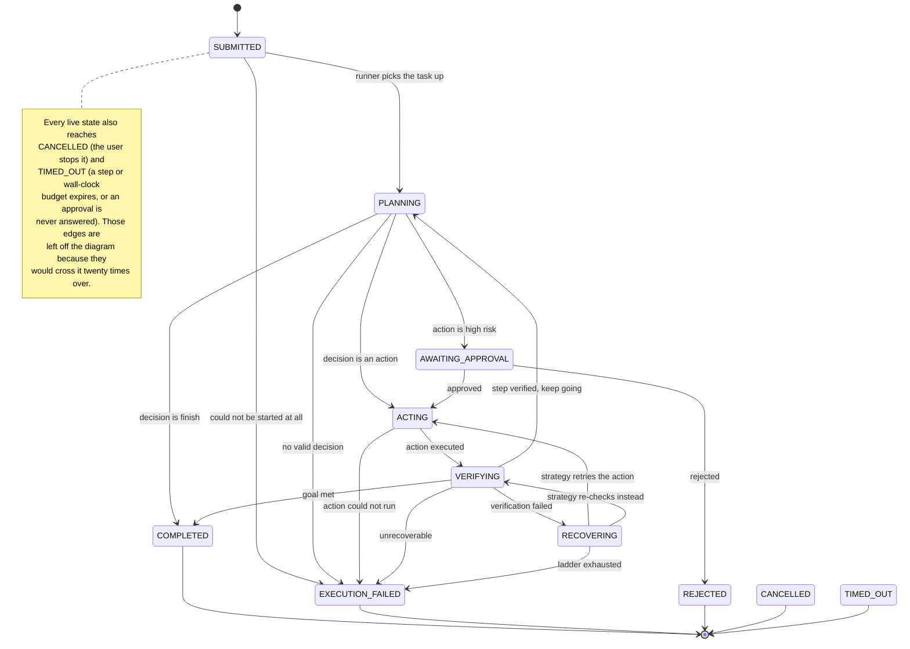
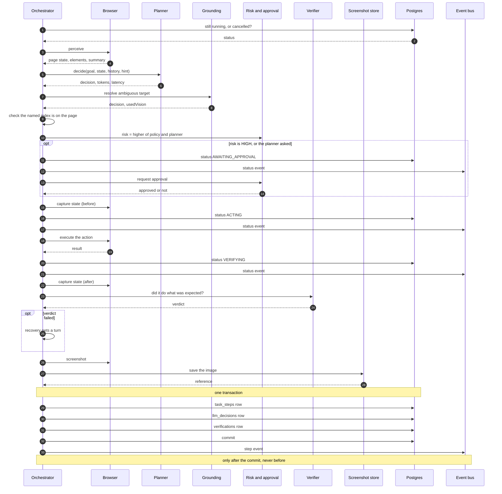

# The agent

How a task moves from submitted to finished, and how a watching client is told
about it. Two pieces, both in this document because neither makes sense alone:
the state machine decides what may happen next, and the event bus is how anyone
outside the loop finds out that it did.

## Task lifecycle

Defined in spec section 4.3 and implemented in
[`app/domain/state_machine.py`](../app/domain/state_machine.py). The table there
is the only place a transition is allowed or refused.



### Reading the table

`ACTING` cannot reach `COMPLETED` directly. That is the point of having a table
at all: spec section 4.7 says the agent does not take its own word for an
outcome, so every action is followed by a verification, and an answer can only
be declared from `VERIFYING` (or from `PLANNING`, where the planner decides the
goal was already met without touching the browser).

`AWAITING_APPROVAL` leads to `ACTING` or `REJECTED` and nowhere else. An
approval is a gate, so there is no path that walks around it.

`RECOVERING` returns to `ACTING` or `VERIFYING` rather than to `PLANNING`.
Recovery works on the step that failed; giving up on the step is
`EXECUTION_FAILED`, not a fresh plan.

`SUBMITTED` reaches `EXECUTION_FAILED` without ever planning. A task whose
browser will not launch, or one left queued when the process died, failed before
it began; without that edge it would have no legal terminal state and would sit
live forever.

Terminal states have no outgoing edges at all, including to `CANCELLED`. A
finished task cannot be cancelled, and a failed one cannot be retried in place:
spec section 6 says a replay creates a new task row.

An illegal transition raises `IllegalTransition` rather than being ignored. A
silent no-op would leave a task sitting in a state nobody chose while the loop
carried on regardless.

## One iteration

Implemented in [`app/agent/orchestrator.py`](../app/agent/orchestrator.py), following
the spec section 4.2 pseudo-code.



### Why the write order is what it is

**Screenshot before rows.** Storage is not transactional, so one of the two has
to go first. If the transaction rolls back after the image is written, an
orphaned file sits in the store until `delete_task` sweeps it, and nothing else
notices. The other order leaves a committed row whose `screenshot_ref` points at
a file that was never written, which is a broken page in the live view and in
every replay of that task afterwards.

**Rows before the event.** Spec section 6.1 lets a client reconnect with
`after_step=<last seen>` and be caught up from the database. That only works if
the database is never behind the live stream. Publishing first opens a window,
however short, where a client can be told about a step it can never fetch again,
and a client that reconnects inside that window is told the step does not exist.

### What is not built yet

Six collaborators are interfaces with do-nothing defaults, listed in
[`app/agent/contracts.py`](../app/agent/contracts.py). Each later part replaces
one default and touches nothing else in the loop.

| Collaborator | Default now | Replaced by |
| --- | --- | --- |
| `Verifier` | Passes everything, recording `verifier: stub` | Real verification |
| `RecoveryStrategy` | Attempts nothing | The recovery ladder |
| `Grounder` | Hands the decision back unchanged | Visual grounding |
| `RiskPolicy` | Adds no rules of its own | The deterministic risk policy |
| `ApprovalGate` | **Refuses everything** | The approval flow |
| `FlowCache` | Never a hit | The flow cache |
| `SessionManager` | Uses the tab id perception found | The tab registry |

The approval gate is the one default that is not a no-op, and deliberately so. A
stub that waves high-risk actions through looks like working software right up
to the day somebody forgets to replace it and an agent buys something. Refusing
fails the task, which is visible immediately and costs nothing.

The stub verifier reports the outcome type the planner asked for, because
`verifications.verification_method` is a Postgres enum of the six section 4.5
types and widening it for a scaffold would mean a migration now and a harder one
to reverse it later. That a check did not really happen is recorded in
`actual_outcome`, which is the free-form column that exists for exactly this.

## Live events

Defined in spec section 6.1 and implemented in
[`app/services/events.py`](../app/services/events.py).

Every event carries `type`, `taskId`, `seq` and `timestamp`. `seq` is per task
and strictly increasing, which is what lets a reconnecting client say how far it
got and lets the server answer honestly.

| Type | Sent when |
| --- | --- |
| `status` | The task changes lifecycle state. |
| `step` | An action was executed, with its screenshot and verification result. |
| `recovery` | A recovery strategy was attempted, and what came of it. |
| `approval_required` | A high-risk action is parked on a human. |
| `approval_resolved` | That human answered. |
| `final` | The task reached a terminal state, with the answer and the stats. |
| `error` | Something went wrong that the client should see. |
| `heartbeat` | Nothing has happened lately and the connection is still alive. |

### Subscribing

`subscribe()` hands back a buffer that is also an async iterator and an async
context manager. Use the context manager, always:

```python
async with bus.subscribe(task_id) as subscription:
    async for event in subscription:
        await websocket.send_json(event.model_dump(mode="json", by_alias=True))
```

The `async with` is what deregisters the subscription when the client goes away,
including when the disconnect arrives as an exception out of the loop body.

### What gives way when a client falls behind

A subscriber that stops reading cannot be allowed to stall the agent loop, so
`publish` never blocks and never raises. It sheds instead, in a fixed order:

1. **Screenshots from the oldest steps.** There are two budgets rather than one,
   because the two costs are a hundredfold apart: a queued step is about a
   kilobyte, its base64 JPEG is far more. The screenshot budget is the smaller
   of the two, which is what makes images the first thing to go. The step
   survives, so the activity log still renders in order, and the image is still
   fetchable from the REST endpoint by step number.
2. **Whole events, oldest first**, once the item budget is also full. Steps,
   recoveries and heartbeats are fair game: a step can be refetched, and the
   next heartbeat is seconds away.
3. **Never `status`, `approval_required`, `approval_resolved`, `final` or
   `error`.** Losing one of those leaves the client permanently wrong rather
   than merely behind: a badge that never updates, a human who is never asked, a
   spinner that never stops. If the queue holds nothing but these, the bound
   gives way and a warning is logged. Too much memory is a bad day; a client
   stuck on the wrong status is a wrong product.

An approval keeps its screenshot through all of this. Somebody being asked to
approve a purchase is entitled to see what they are approving.

### The in-memory limitation

`InMemoryEventBus` fans out within one process. With more than one worker, a
client connected to worker A never sees events published on worker B. That is
acceptable for now and not acceptable at scale, which is why `EventBus` is an
abstract base class: a Redis pub/sub implementation drops in behind the same
interface, taking its sequence numbers from `INCR`, without the orchestrator or
the WebSocket route changing at all.
