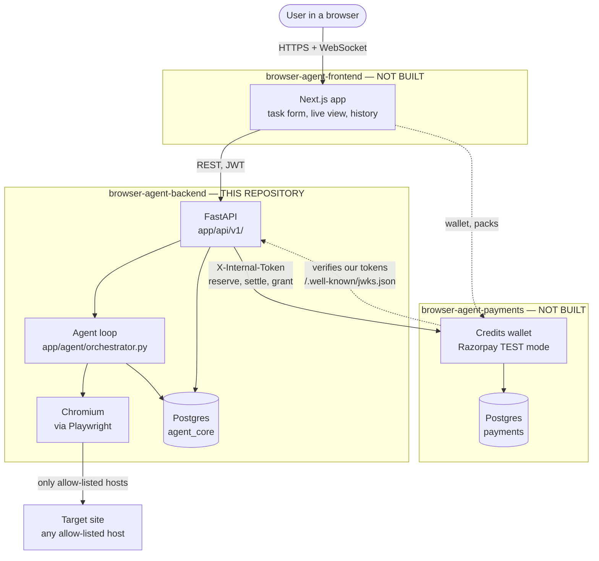
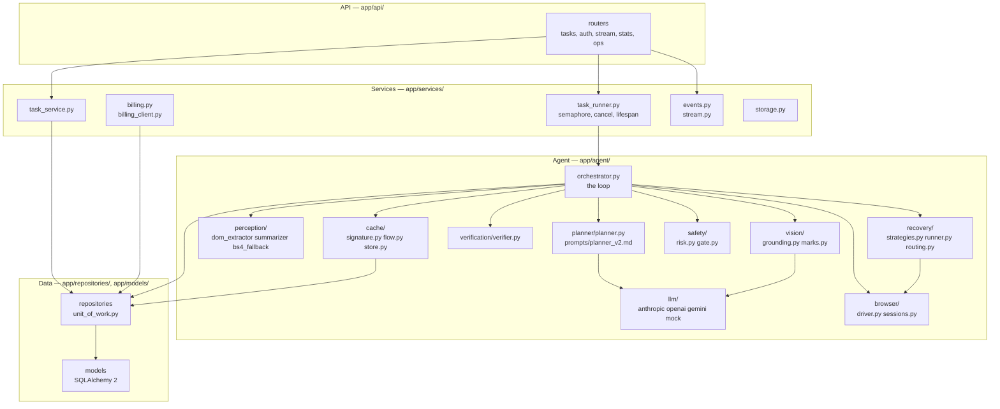
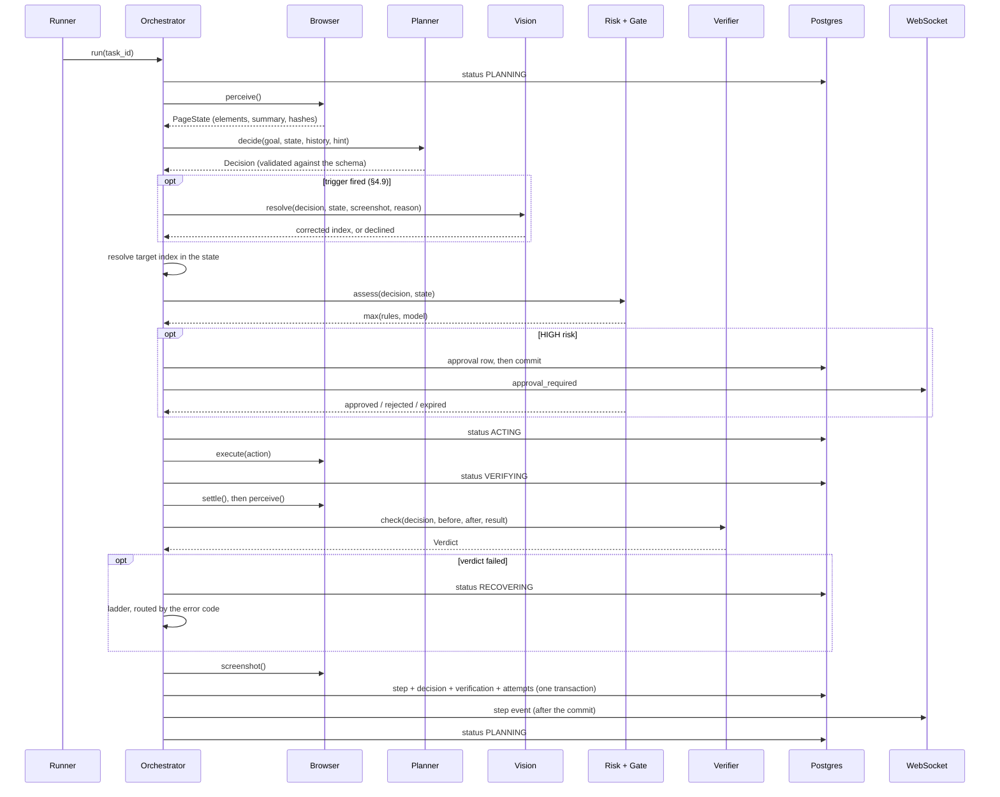
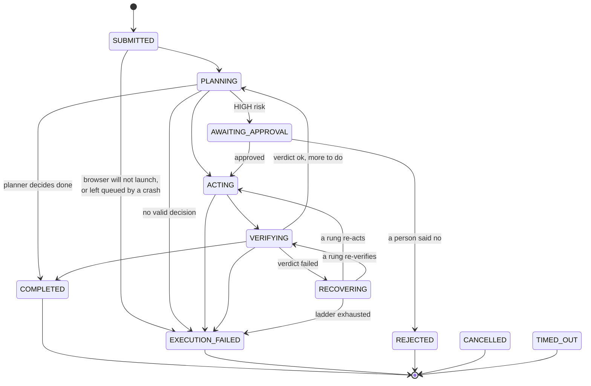
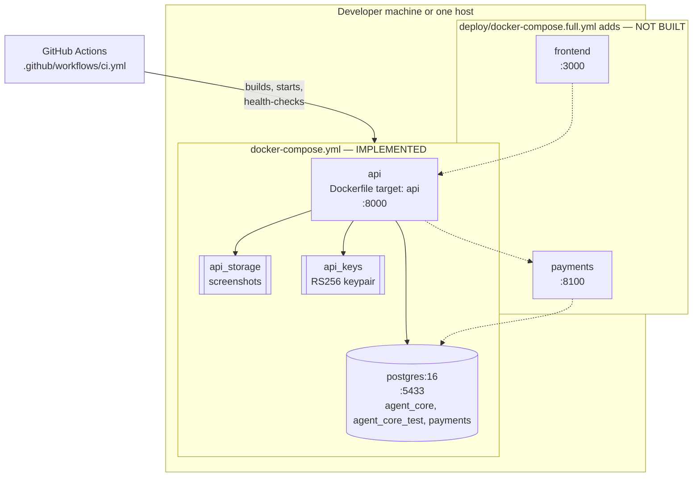

# Architecture

Five diagrams and what each one is for. Everything drawn here exists in the
repository unless a note says otherwise, and the future work is marked rather
than drawn optimistically: a diagram that shows a component nobody has written is
a diagram that gets somebody's hopes up in a review.

Paths are real. If a box names a file, that file is on disk.

## 1. System context

AI-07 is three repositories. This one is the backend and the agent; the other two
are separate services with their own databases.

**Implemented:** everything inside the backend box, plus the client
side of the payments contract (`app/services/billing_client.py`) and its
`docs/billing-integration.md` specification.

**Not built:** the frontend and the payments service. The backend runs with
`BILLING_ENABLED=false` by default and is fully usable from `/docs` or curl, so
neither is a prerequisite for a demo.

The dashed lines are the two directions that cross a repository boundary without
a person in between: the backend calls payments over an internal API, and
payments verifies the backend's JWTs by fetching its JWKS. Both are specified in
`docs/billing-integration.md` and `docs/auth.md`.

## 2. Agent layers

Spec section 4.1's table, as a picture. The arrows are dependencies, so they all
point the same way: `app/agent/` never imports FastAPI, and nothing in the agent
imports a service.

Every collaborator the loop uses is a Protocol in `app/agent/contracts.py` with a
default implementation. That is not decoration: it is what lets
`tests/unit/test_orchestrator.py` drive the whole loop against a fake browser
with no Chromium at all, and it is why each part could replace one default
without touching the loop.

## 3. One loop iteration

The sequence for a single step, in the order things actually happen. Spec section
4.2 is the pseudo-code; this is what the code does.

Two orderings in that diagram are load-bearing and were each argued about in a
phase note.

**The screenshot goes to storage before the row is written**, so the row can
carry a reference that already resolves. The reverse order leaves a committed row
pointing at a file that does not exist.

**The step event is published after the commit**, never inside the transaction.
A client told about a step it can never fetch again is worse than a client told
slightly late.

## 4. Task state machine

Generated from `app/domain/state_machine.py`. Illegal transitions raise rather
than being logged and ignored.

`CANCELLED` and `TIMED_OUT` are reachable from **every** non-terminal state and
are left off the diagram's edges for legibility: drawing them would add ten
arrows and say one thing. A user may cancel at any point, either budget may
expire mid-step, and an unanswered approval expires to `TIMED_OUT` rather than
`REJECTED` — `REJECTED` means a person looked and said no (decision A4).

## 5. Deployment

What `make up` starts, and what the full stack adds.

The API container runs migrations and generates a signing key on first start, so
`make up` on an empty machine produces a working service without a setup step.
The key lives on a volume: regenerating it per restart would invalidate every
token already issued.

**Not built:** any deployment beyond one host. CI builds the images and throws
them away — there is no registry, and nothing orchestrates more than one replica.
The application is written to tolerate several (`FOR UPDATE SKIP LOCKED` on the
outbox, Alembic serialising on its own version row), but three things are
explicitly per process and documented as such: the event bus, the rate limiter
and the WebSocket ticket store.

## What is implemented, in one table

| Area | State | Where |
|---|---|---|
| Auth, RBAC, refresh rotation | Implemented | `app/api/v1/auth.py`, `app/services/auth.py` |
| Task lifecycle and API | Implemented | `app/api/v1/tasks.py`, `app/domain/state_machine.py` |
| Browser driver, multi-tab | Implemented | `app/agent/browser/` |
| Perception and summarisation | Implemented | `app/agent/perception/` |
| Planner, four providers | Implemented | `app/agent/planner/`, `app/agent/llm/` |
| Visual grounding (set-of-marks) | Implemented | `app/agent/vision/` |
| Deterministic verification | Implemented | `app/agent/verification/verifier.py` |
| Recovery ladder, error-code routing | Implemented | `app/agent/recovery/` |
| Risk policy and human approval | Implemented | `app/agent/safety/` |
| Flow cache and replay | Implemented | `app/agent/cache/` |
| Live WebSocket stream | Implemented | `app/api/v1/stream.py`, `app/services/stream.py` |
| Metrics and stats | Implemented | `app/core/metrics.py`, `app/services/stats.py` |
| Billing client and outbox | Implemented (client side) | `app/services/billing*.py` |
| SkyFare test site, nine chaos toggles (chaos suite and benchmark only, not deployed) | Implemented | `tests/skyfare/` |
| Docker images, compose, CI | Implemented | `Dockerfile`, `docker-compose.yml`, `.github/` |
| Payments service | **Not built** | separate repository |
| Frontend | **Not built** | separate repository |
| S3 screenshot storage | **Not built** | `ScreenshotStorage` protocol is ready for it |
| Redis rate limiting, shared event bus | **Not built** | both behind interfaces |
| Deployment beyond one host | **Not built** | no registry, no orchestration |

## Where the numbers are

`docs/benchmarks/2026-09-28-mock.md` is the headline run: thirty runs, ten chaos
configurations, 100% end-to-end success and 100% recovery against targets of 80%
and 70%. It uses the mock provider, which is rule-based and offline, so it
measures the loop, the verifier and the recovery ladder rather than a model's
judgement.

`docs/benchmarks/2026-09-29-gemini.md` is a live attempt that produced no usable
measurement: the provider answered every request with 503. It is kept because
what it does show is the degradation path working — five clean failures with a
readable reason and no crash.
