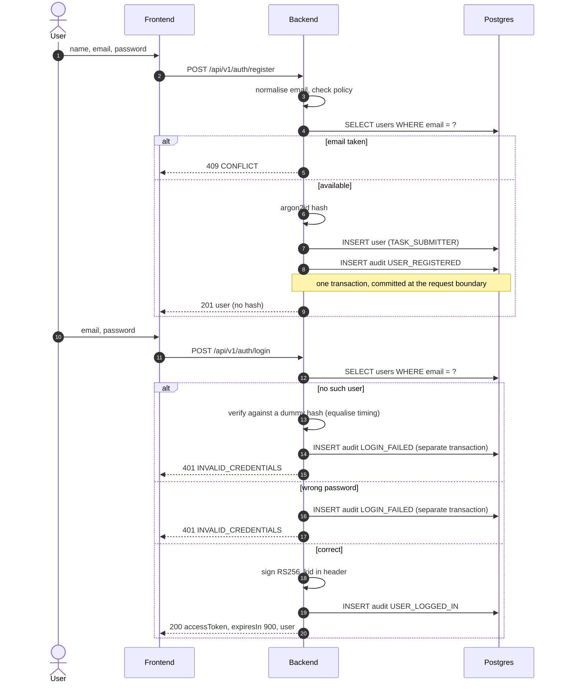
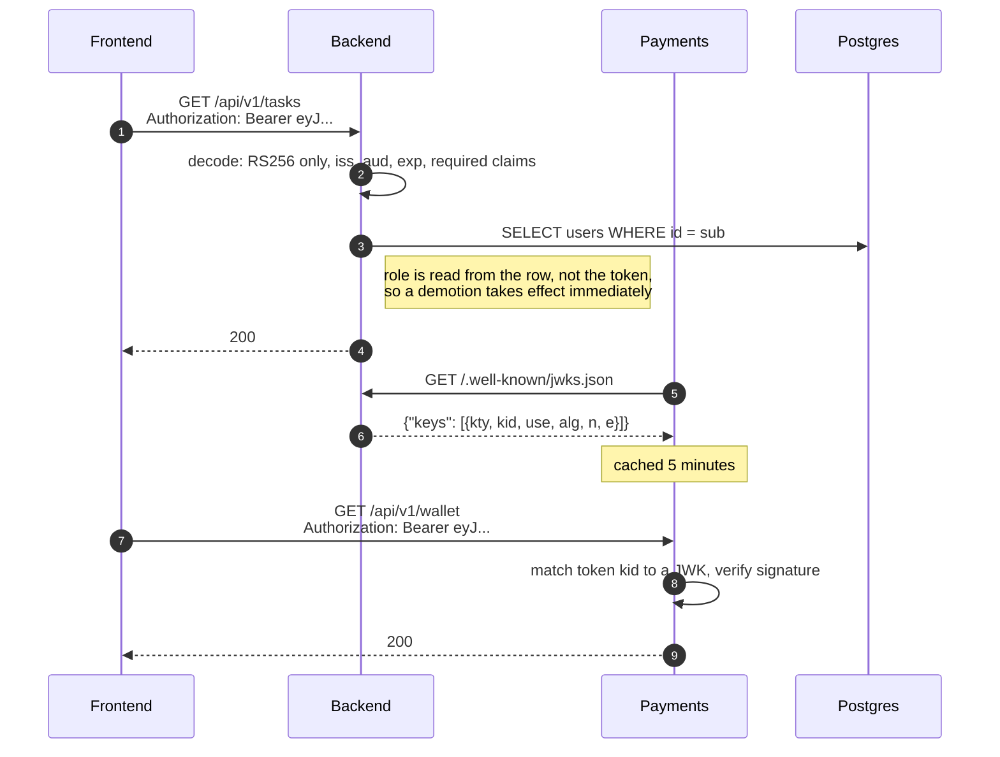
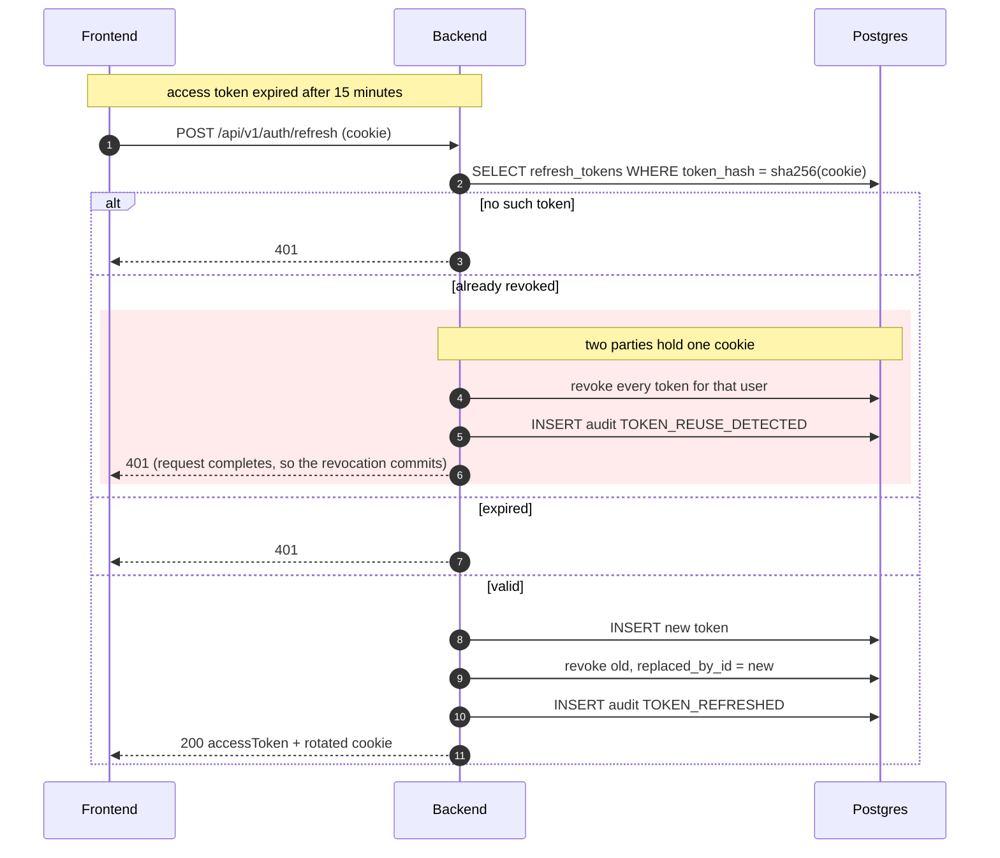

# Authentication

The backend is the **only identity provider** in this system (spec section 2). It mints RS256 access tokens and publishes the matching public key; the payments service verifies tokens against that key and never holds a secret of its own.

As of B07: register, login, refresh rotation with reuse detection, logout, `/auth/me`, role checks and rate limiting.

## Why asymmetric

With HS256 both services would share one secret. A compromise of payments would then let an attacker mint tokens the backend accepts, and rotating the key would mean a coordinated deploy of both services.

With RS256 the private key never leaves this process. Payments fetches `/.well-known/jwks.json`, picks the key named by the token's `kid`, and verifies. It can do that offline, cache it, and never call back. Rotation means publishing a second key in the JWKS, switching signing to it, and retiring the old one once the 15 minute access TTL has elapsed.

## Register and login



## Using a token, and how payments verifies it



The published document carries only `n` and `e`, the public modulus and exponent. There is no path from it back to the signing key.

## The refresh cookie

The refresh token is **opaque**, not a JWT. A refresh token's whole job is to be revocable, and a self-contained token cannot be revoked without a server-side list; since the list is needed either way, the token carries no claims.

Only its SHA-256 hash is stored. Not argon2, deliberately: slow hashing defends a *low-entropy* secret a human chose against offline guessing, whereas this value is 384 random bits, and refresh is a hot path that needs an indexed equality lookup. A dump of the table still cannot be replayed, which is the property that matters.

| Cookie attribute | Value | Why |
|---|---|---|
| `httpOnly` | yes | Unreadable from JavaScript, so an XSS bug cannot exfiltrate a 7 day session |
| `SameSite` | `Lax` | Not sent on cross-site subrequests |
| `Secure` | only when `APP_ENV=prod` | Setting it in dev would drop the cookie over plain http |
| `path` | `/api/v1/auth` | A cookie sent on every request is exposed on every request; only these routes consume it |
| `max-age` | `REFRESH_TOKEN_TTL_DAYS` | 7 days, spec section 2 |

**A cross-domain deployment needs more.** `SameSite=Lax` works while the frontend and backend share a registrable domain, which `localhost:3000` and `localhost:8000` do. If the frontend is served from a different domain in production, the cookie needs `SameSite=None; Secure` and a CORS policy with credentials, or the browser will silently drop it.

## Rotation and reuse detection



Rotation is **single-use**: every refresh invalidates the token that was presented and issues a new one. That turns a stolen cookie from a seven day pass into a race, and `replaced_by_id` records the chain so the race is detectable.

If a revoked token is presented again, **every session for that user is revoked**. Two parties hold one cookie and there is no way to tell which is the thief, so both are cut off and the real user logs in again. The legitimate session dying is the cost, and it is the right cost: the alternative leaves an attacker with a live session.

**Why the 401 does not discard the revocation.** The chain revocation is written in the request's own transaction, because the rows it touches are that transaction's state and a second connection cannot see them. An exception escaping the route would roll it back at exactly the wrong moment, so the route catches `RefreshTokenReuse` and *returns* the 401 instead of raising it. The request finishes normally, and the revocation commits with it.

The failed-login audit from B06 still uses a separate transaction, and the difference is principled: that write depends on nothing in the request's transaction, being one row with no actor and no foreign key, so a second connection can safely do it.

## Logout

`POST /api/v1/auth/logout` revokes the presented token and clears the cookie. It is idempotent and always returns 204: logging out is a request to end a session, and a client that has already lost its cookie has achieved that. Failing would only make the frontend handle an error it cannot act on.

## Roles

`require_roles(*roles)` returns 403 when an authenticated caller has the wrong role, and the bearer dependency returns 401 when there is no valid token at all.

- **401** means "we do not know who you are".
- **403** means "we do, and you may not".

Conflating them would tell an unauthenticated caller that the resource exists and that some role can reach it.

**ADMIN is not implied.** Every route lists the roles it accepts, so reading the route tells you exactly who can reach it:

```python
@router.post("/tasks/{id}/approve",
             dependencies=[Depends(require_roles(UserRole.APPROVER, UserRole.ADMIN))])
```

Roles above `TASK_SUBMITTER` are not self-service. Create them with:

```bash
python scripts/create_admin.py --email you@example.com --name "Your Name" --role ADMIN
```

The password is prompted for rather than passed as an argument, because an argument lands in shell history and in the process list.

## Rate limiting

Spec section 10 requires throttling on auth. `RateLimiter` is a small interface with an in-memory **token bucket** behind it.

| Route | Limit |
|---|---|
| `POST /auth/login` | 5 per minute |
| `POST /auth/register` | 3 per minute |
| `POST /tasks` | 10 per minute (wired when the endpoint lands) |

Buckets are keyed on route name plus client address, so exhausting the login quota does not also block registration. Exceeding a limit returns **429** in the standard error envelope with a `Retry-After` header in whole seconds, never zero.

A token bucket rather than a fixed window: a fixed window lets a caller spend the whole quota in the last second of one window and again in the first second of the next, which is twice the intended rate at the boundary. The bucket refills continuously, so the average is what was asked for while a genuine burst is still allowed.

Two limits of the current implementation, both deliberate and both documented in `app/core/rate_limit.py`:

- **Per process.** Two workers each allow the full quota. Fine for one process; behind a load balancer the fix is a shared implementation of the same interface, not a larger number.
- **`X-Forwarded-For` is ignored by default.** Any client can send that header, and believing it hands every caller a fresh bucket. Enable `RATE_LIMIT_TRUST_FORWARDED_FOR` only behind a proxy you control.

## Token contents

Header:

```json
{ "alg": "RS256", "kid": "browser-agent-key-1", "typ": "JWT" }
```

Claims:

| Claim | Meaning |
|---|---|
| `sub` | User id (uuid) |
| `role` | `TASK_SUBMITTER`, `APPROVER` or `ADMIN`, as it was at sign time |
| `iss` | `JWT_ISSUER`, checked on decode |
| `aud` | `JWT_AUDIENCE`, checked on decode |
| `iat` | Issued at |
| `exp` | Expiry, 15 minutes after `iat` (spec section 2) |
| `jti` | Unique token id |

`jti` is unused today. It is what a revocation list or replay check would key on, and it costs nothing to include from the start; adding it later would mean every already-issued token lacks it.

## What decode rejects

`decode_access_token` passes `algorithms=["RS256"]`, an allow-list of exactly one. That single argument closes two classic attacks:

- **`alg: none`** — a token asserting it needs no signature.
- **RS256 to HS256 downgrade** — the public key is, by definition, public. A verifier that accepted HS256 would treat it as a shared secret, and anyone who fetched the JWKS could mint an admin token.

Both have tests, the second built by hand because PyJWT refuses to *encode* HS256 with a PEM and an attacker is not using PyJWT.

Also rejected: expired tokens, a wrong `iss` or `aud`, a tampered payload or signature, and a token missing any required claim. Every one produces the same `401 UNAUTHORIZED`; the specific reason goes to the log, not to the client.

## Credentials are opaque on failure

A wrong password and an unknown email return the identical code, message and status. Distinguishing them turns the login form into an account-existence oracle, so the failure path is deliberately uniform:

- Both raise `InvalidCredentials` (`401 INVALID_CREDENTIALS`).
- When no user is found, the server still runs an argon2 verification against a throwaway hash, so the response time does not reveal whether the account exists.
- A malformed email at login fails as `401`, not `400`, for the same reason.

**Registration is the deliberate exception.** A duplicate email returns `409`, as the part specification requires, which does confirm the address is registered. That is the normal trade: a register form that silently accepts a duplicate is unusable. The mitigation belongs at the edge, in the rate limiting that lands in B10.

## Password rules

| Rule | Value | Why |
|---|---|---|
| Minimum length | 10 | Specified |
| Not all digits | enforced | A 10 digit number is trivially enumerable |
| Maximum length | 256 | argon2 has no bcrypt-style truncation, but an unbounded password is unbounded work for the server |
| Hash | argon2id | Memory-hard, so GPU cracking is expensive |

Hashes are salted per password: the same password registered twice produces different digests.

## Where the audit rows go

`USER_REGISTERED` and `USER_LOGGED_IN` are written in the request's transaction and commit with it.

`LOGIN_FAILED` cannot be. The request is about to raise a 401, and the request transaction is rolled back on the way out, so a record written through the request's session would be discarded exactly when it matters most. `AuthService._audit_failed_login` therefore opens its **own** session and commits it before the error propagates.

This is the one sanctioned exception to the B05 rule that services never commit. It is not a convenience: a security review asking "was this account under attack last Tuesday" needs the failed attempts, and they are precisely the requests that failed. The password is never part of the record; the email and a reason code are.

## Keys

```bash
python scripts/gen_keys.py
```

Writes `keys/jwt_private.pem` (mode 0600) and `keys/jwt_public.pem`, then prints the env lines. `keys/` is gitignored, and the script refuses to overwrite an existing key without `--force`, because replacing it invalidates every token already issued.

The keypair is loaded once at startup. If it is missing the service fails to start, rather than accepting registrations and then failing every login.

## Settings

| Setting | Default | Notes |
|---|---|---|
| `JWT_ALGORITHM` | `RS256` | |
| `JWT_ISSUER` | `browser-agent-backend` | Checked on decode |
| `JWT_AUDIENCE` | `browser-agent` | Checked on decode |
| `JWT_KID` | `browser-agent-key-1` | Names the key in the JWKS; change to rotate |
| `JWT_PRIVATE_KEY_PATH` | `keys/jwt_private.pem` | Never committed |
| `JWT_PUBLIC_KEY_PATH` | `keys/jwt_public.pem` | Published as JWKS |
| `ACCESS_TOKEN_TTL_MIN` | `15` | Spec section 2 |
| `REFRESH_TOKEN_TTL_DAYS` | `7` | Spec section 2 |
| `RATE_LIMIT_ENABLED` | `true` | |
| `RATE_LIMIT_LOGIN_PER_MINUTE` | `5` | |
| `RATE_LIMIT_REGISTER_PER_MINUTE` | `3` | |
| `RATE_LIMIT_TASK_CREATE_PER_MINUTE` | `10` | Used when POST /tasks lands |
| `RATE_LIMIT_TRUST_FORWARDED_FOR` | `false` | Only behind a proxy you control |
