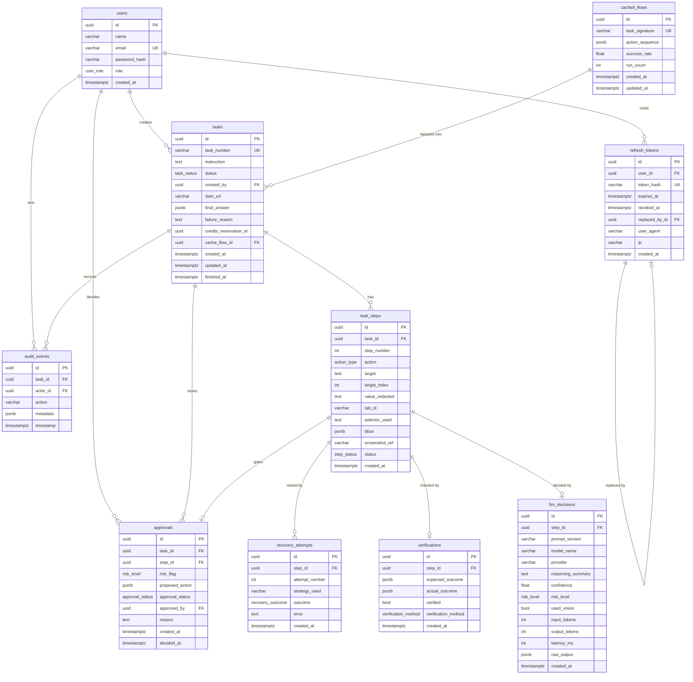

# Database

Postgres 16, database `agent_core`. Ten tables: the nine from [spec section 5](PROJECT_SPEC.md#5-backend-database-postgres-db-agent_core) plus `refresh_tokens`.

Models live in `app/models/`, grouped by aggregate. Enums are native Postgres types defined in `app/domain/enums.py`.

## Entity relationships



## Tables

### users

Identity. `email` is unique and is the login handle. `password_hash` is an argon2 digest and is never logged (spec section 10). `role` drives approval permissions: only `APPROVER` or the task owner may decide an approval (spec section 6).

### refresh_tokens

Not in the original documentation. Section 2 specifies a 7 day httpOnly refresh cookie, and rotating one safely means the server must know what it issued. Only `token_hash` is stored, so a dump of this table cannot be used to mint sessions. `replaced_by_id` points at the token that superseded this one, which makes reuse of an already-rotated token detectable, the usual signal that a refresh cookie was stolen. `revoked_at` supports logout and forced revocation.

### tasks

The aggregate root. `task_number` is the human-facing identifier (`T-000001`), generated by a Postgres sequence rather than a `SELECT MAX() + 1`, so concurrent inserts cannot collide. `credits_reservation_id` deliberately has no foreign key: reservations live in the payments service's own database (spec section 7), so it is an opaque identifier here. `cache_flow_id` is `ON DELETE SET NULL`, so invalidating a cached flow does not delete the tasks that used it.

Deleting a user who owns tasks is blocked (`ON DELETE RESTRICT`).

### task_steps

One executed action, dense per task: `unique(task_id, step_number)` is stated in spec section 5 and matters for the WebSocket replay in section 6.1, where the client reconnects with `after_step=N`. `action` is constrained to the section 4.4 allow-list at the database level, not just in code. `value_redacted` holds the masked form of anything typed; the real value never leaves memory (spec section 10).

### llm_decisions

One row per planner call. Section 9 requires the model name and prompt version on every step, which is what makes a run auditable and costable afterwards. Token counts and `latency_ms` are nullable because the mock provider does not report them.

### verifications

The deterministic outcome check from section 4.7. `expected_outcome` is what the planner claimed would happen; `actual_outcome` is what was observed. `verified` is the verdict that decides whether recovery runs.

### recovery_attempts

One row per attempt from the seven-strategy ladder in section 4.8. `strategy_used` is text rather than an enum on purpose: the ladder is expected to gain rungs, and adding one should not need a migration. All attempts failing drives the step to `EXECUTION_FAILED`.

### approvals

The human-in-the-loop gate. `step_id` is nullable because an approval can be raised for a proposed action before the step row exists. An approval that times out is recorded `EXPIRED` and drives the task to `TIMED_OUT`; `REJECTED` means a person actually rejected it (decision A4). Indexed on `(task_id, created_at)` because the queue is read per task, newest first.

### audit_events

Uses `timestamp`, not `created_at`, because that is the column name the spec gives. Both `task_id` and `actor_id` are nullable: not every audited action belongs to a task (a login), and not every actor is a person (the expiry job). The column is `metadata` in Postgres but maps to `event_metadata` on the model, because `metadata` is reserved on a SQLAlchemy declarative class (decision A11).

### cached_flows

A verified action sequence keyed by `task_signature`, which is `sha256(normalized_instruction + start_domain)` and therefore always 64 hex characters. `success_rate` and `run_count` drive the invalidation rule in section 4.12: below 0.5 after at least three runs, the row is dropped from use.

## Conventions

**Constraint naming.** `app/db/base.py` sets a naming convention on the metadata (`pk_`, `fk_`, `uq_`, `ix_`, `ck_`). Without it, Postgres invents names that never match SQLAlchemy's `None`, and every `alembic revision --autogenerate` proposes dropping and recreating constraints that have not changed.

**Identifiers.** Every primary key is a `uuid`, defaulted on both sides: `uuid4()` for ORM inserts and `gen_random_uuid()` for anything else. Postgres 16 has that function in core, so there is no `pgcrypto` extension to install.

**Timestamps.** All `timestamptz`, never naive. `created_at` and `updated_at` have server defaults. `updated_at` is maintained by SQLAlchemy's `onupdate`, which is client-side, so a raw `UPDATE` will not move it.

**Relationships are `lazy="raise"`.** Nothing loads implicitly. Touching an unloaded relationship raises rather than emitting a surprise query, which in async SQLAlchemy would otherwise fail confusingly at await time or silently serialise an N+1. Loading is explicit, via `selectinload` or `joinedload` at the query site.

**Indexes are exactly what spec section 5 lists**, plus `unique(task_id, step_number)` and, for the added table, `refresh_tokens.user_id` and `token_hash`. Notably `approvals.step_id`, `tasks.created_by` and `audit_events.actor_id` are not indexed; if those lookups show up in the slow log, that is a deliberate later decision rather than an oversight.

## Migrations

```bash
make migrate                      # upgrade head
make revision m="add something"   # autogenerate, then read what it produced
make downgrade                    # back one revision
```

Autogenerate does not handle sequences, emits a duplicate `CREATE TYPE` when two tables share an enum, and never drops enum types on downgrade. `migrations/versions/a78013bebd3a_*.py` documents all three at the top. Read every generated migration before committing it.
